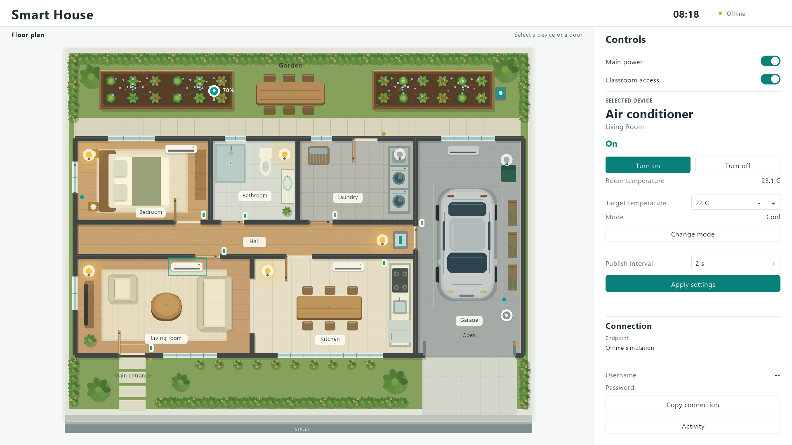

# Smart Home Playground

An interactive smart-home simulator for teaching IoT and MQTT. Students read
sensor data and build their own automation in Python while an animated 2D
house responds to their commands.



The playground running in Offline mode at 1920 x 1080.

## What it provides

- Seven rooms with independent lighting, four air conditioners, a motorized
  garage, and irrigation covering two garden beds.
- Interactive manual doors and a window, contact sensors, motion and vehicle
  detection, temperature readings, and soil moisture.
- A resizable interface designed around 1920 x 1080, with a contextual device
  inspector, connection details, and activity history.
- A time-only clock: one simulated day takes four real minutes by default.
- Authenticated MQTT in Docker, with a public WSS tunnel for remote students.

**Students write the automation.** The simulator provides the environment,
sensors, and actuators. Students build rules for lighting, irrigation, and
schedules in their own programs. The local simulation generates sensor
readings and the clock. Manual doors and windows are operated in the scene;
the motorized garage also accepts MQTT commands.

Built with Python, Pyglet, Paho MQTT, Mosquitto, and Cloudflare Tunnel.

## Quick start

Requirements: **Windows, Python 3.11+, and Docker Desktop using Linux
containers**. Start Docker Desktop before using a networked mode. Offline
mode requires only Python and the installed dependencies.

```powershell
git clone https://github.com/ThiNepo/smart-home-playground.git
cd smart-home-playground
.\Start.ps1
```

The script creates `.venv`, installs dependencies, starts the broker and
tunnel, verifies an MQTT connection, and opens the house.

| Command | Mode |
| --- | --- |
| `.\Start.ps1` | Local broker and public WSS access |
| `.\Start.ps1 -Local` | Local broker without a public tunnel |
| `.\Start.ps1 -Offline` | Standalone simulation without Docker or MQTT |

If script execution is restricted, start it directly:

```powershell
python -m venv .venv
.\.venv\Scripts\python.exe -m pip install -r requirements.txt
.\.venv\Scripts\python.exe main.py
```

Closing the window or pressing Ctrl+C stops the application's containers.
After a forced termination, clean up with
`docker compose -p smart-house-demo --profile remote down`.

## Using the house

Click a room, fixture, door, sensor, vehicle, or pump to select it, then use
the controls on the right. Doors remain interactive without a contact sensor.
Main power affects powered actuators; sensors and the clock continue running.
Classroom access can be paused while local controls and telemetry remain active.

The connection panel and `.runtime/connection.json` contain the current
endpoint and credentials. The shared username is `classroom`; a six-character
alphanumeric password is generated locally and reused between sessions.
All students share the MQTT account and can subscribe and publish to
`house/#`. Each student client uses a unique connection ID.

The public tunnel address changes between sessions. Startup waits up to
90 seconds for it; if unavailable, local MQTT remains available.

## Simulation configuration

Edit [config/simulation.json](config/simulation.json) and restart the application.
The file is validated before Docker starts.

| Group | Controls |
| --- | --- |
| `clock` | Start time, real seconds per simulated day, and publication interval in simulated minutes |
| `devices` | Default sensor reading and device publication intervals |
| `environment` | Initial readings, ambient conditions, soil drying/watering rates, car presence, and motion timeout |
| `openings` | Manual door, window, and garage movement duration |

Only the clock accelerates: its defaults are `08:00`, 240 real seconds per
day, and one publication per simulated minute, approximately six messages
per real second. Sensor intervals, physical movement, and environmental rates
use **real seconds**. Device settings changed through the UI or MQTT apply
in memory and reset to startup defaults on restart.

## Connecting a student program

From the cloned repository, install the MQTT client and subscribe using the
public URL supplied by the teacher:

```powershell
python -m pip install paho-mqtt==2.1.0
python examples/student.py --url wss://YOUR-CLASSROOM.trycloudflare.com/mqtt
```

The example prompts for the shared password and prints incoming readings,
actuator states, and clock updates for 30 seconds. To send a command as well:

```powershell
python examples/student.py --url wss://YOUR-CLASSROOM.trycloudflare.com/mqtt --topic house/living_room/light/set --value ON
```

| Purpose | Topic | Example payload |
| --- | --- | --- |
| Read a sensor or actuator state | `house/<area>/<device>/state` | `{"value":54.45,"config":{"read_interval":1,"publish_interval":5}}` |
| Command an actuator | `house/<area>/<device>/set` | `ON`, `OFF`, or `OPEN` / `CLOSE` for the garage |
| Configure a device | `house/<area>/<device>/config/set` | `{"read_interval":1,"publish_interval":5}` for a sensor |
| Read the clock | `house/clock/state` | `{"value":"08:15"}` |
| Check availability | `house/status` | `online` / `offline` |

Subscribe to `house/#` for all messages. States use QoS 1 and are retained;
commands must use `retain=False`. Sensor sampling and publication intervals
are independent. Actuator commands and applied configuration are confirmed
through state messages. All students control the same house.

The reusable `StudentClient` provides `connect`, `set`, `configure`, `state`,
and `close`. See the **[MQTT reference](docs/mqtt.md)** for the complete device
catalog, allowed settings, payloads, and an object-oriented Python example.

## Project structure

| Path | Responsibility |
| --- | --- |
| `smarthouse/` | Object-oriented device model, local simulation, rendering, MQTT, and Docker lifecycle |
| `config/simulation.json` | Local environment and clock configuration |
| `examples/student.py` | Reusable student client and command-line example |
| `tests/` | Model, protocol, graphical, and real-broker tests |
| `docs/mqtt.md` | MQTT interface reference |
| `design/` | Interface proposals and implementation previews |

## Tests

After setup, run pytest from the repository root:

```powershell
.\.venv\Scripts\python.exe -m pytest -q                 # No Docker or display required
.\.venv\Scripts\python.exe -m pytest -m gui -q          # Requires a graphical display
.\.venv\Scripts\python.exe -m pytest -m integration -q  # Requires Docker
```

Integration tests use an isolated broker, temporary credentials, and separate
ports. To include a real public WSS connection, set
`$env:SMART_HOUSE_REMOTE_TEST = '1'` before running them.

To render a preview without starting Docker:

```powershell
.\.venv\Scripts\python.exe main.py --offline --screenshot .runtime/preview.png
```

## License

Licensed under the [Apache License 2.0](LICENSE).
